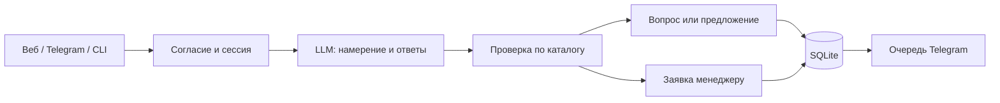

# LeadPilot AI

[](https://github.com/Kera-0/LeadPilot-AI/actions/workflows/tests.yml)


ИИ-продавец для образовательного бизнеса: понимает свободный запрос, квалифицирует клиента, подбирает курс из базы знаний и передаёт заявку менеджеру с историей. Есть браузерный чат, Telegram и терминальный режим.

**Это MVP для демонстрации.** Каталог содержит три вымышленных курса английского с учебными ценами. Это явно указано в интерфейсе. Покупка и реальная запись не выполняются.

## Быстрый запуск

Нужны Python 3.12+ и ключ API с доступом к выбранной модели. Подписка на чат сама по себе ключом API не является.

```powershell
git clone https://github.com/Kera-0/LeadPilot-AI.git
cd LeadPilot-AI
python -m venv .venv
.\.venv\Scripts\python -m pip install -r requirements.txt
Copy-Item .env.example .env
```

Откройте `.env`, заполните `OPENAI_API_KEY`. Модель по умолчанию в примере — `gpt-4o-mini`; можно указать другую модель с поддержкой Responses API и Structured Outputs.

```powershell
.\.venv\Scripts\python run.py
```

Откройте **http://127.0.0.1:8000**. Документация HTTP API: **http://127.0.0.1:8000/docs**.

На Linux/macOS используйте `.venv/bin/python` и `cp .env.example .env`. После изменения `.env` перезапустите приложение. `.env`, база и виртуальное окружение не попадают в Git.

Без ключа интерфейс запускается, но прямо сообщает, что LLM не настроена. Подмена ИИ сценарными ответами не используется. Наличие ключа не гарантирует доступ к модели: для этого есть отдельная живая проверка.

## Как показать MVP за две минуты

1. Откройте чат и дайте согласие на обработку текста.
2. Напишите: «Мне нужен английский для работы: участвую во встречах, основы уже знаю. Хочу начать через месяц, только онлайн. Бюджет до 10000 рублей, решение принимаю сам».
3. В карточке слева появятся извлечённые ответы; ассистент предложит подходящий курс из каталога. Несколько ответов в одном сообщении сокращают опрос.
4. Напишите «Дорого» — появится уточняющий вопрос, причина возражения сохранится в аналитике.
5. Попросите гарантию или несуществующую скидку: бот не должен придумывать условия. После трёх непонятных запросов предложит человека.
6. Нажмите «Позвать менеджера»: заявка и история сохранятся; при настроенном Telegram worker уведомление уйдёт менеджеру.

Веб-чат хранит сессию в HttpOnly cookie. После обновления страницы история и ответы восстанавливаются. Другой браузер получает отдельный диалог.

## Ключевая LLM-функция

Это не набор кнопок с имитацией ИИ. Каждый свободный содержательный запрос отправляется в модель:

- LLM определяет намерение: ответ, рекомендация, FAQ, возражение, жалоба или просьба о человеке.
- Извлекает цель, проблему, уровень, сроки, формат, бюджет и принимающего решение. Учитывает контекст коротких ответов и опечатки.
- Выбирает ID курса из переданного каталога, распознаёт FAQ и шесть типов возражений.
- Возвращает строго типизированный `Understanding` через Structured Outputs.

Сервер повторно проверяет выбор по цели, уровню, формату и бюджету. Неизвестный ID отбрасывается. Если после новых ответов выбор модели перестал подходить, выбирается самый дешёвый подходящий вариант; если вариантов нет — человек. Цены, сроки и описания подставляются непосредственно из JSON, а не генерируются моделью. FAQ возвращается дословно из базы.



Промпт: [leadpilot/prompts.py](leadpilot/prompts.py). Схема и API-вызов: [leadpilot/llm.py](leadpilot/llm.py). Логика проверок: [leadpilot/service.py](leadpilot/service.py).

## Telegram и голосовые — дополнительно

Для браузерного демо Telegram не нужен. Чтобы подключить канал, создайте бота через @BotFather, начните с ним диалог от аккаунта менеджера и заполните:

```dotenv
TELEGRAM_BOT_TOKEN=...
MANAGER_CHAT_ID=...
```

```powershell
.\.venv\Scripts\python bot.py
```

Один процесс polling на токен, без webhook. Offset сохраняется в SQLite; повтор входящего update не вызывает LLM второй раз. Очередь уведомлений переживает перезапуск, ошибки доставки повторяются с увеличением интервала. При сбое между отправкой Telegram и фиксацией результата уведомление может продублироваться: доставка как минимум один раз.

Чтобы получать заявки из веб-чата в Telegram, параллельно веб-серверу запустите:

```powershell
.\.venv\Scripts\python bot.py --worker
```

Менеджеру передаются ответы, выбранный курс, причина эскалации и история; последующие дополнения также попадают в очередь. Уведомление не означает автоматического открытия личного чата с клиентом: дальнейший контакт организует менеджер.

Голосовые Telegram распознаются через аудиомодель после согласия, лимит 10 МБ. При недоступном API бот просит написать текстом. В браузере поддержан текст.

Для живого терминального диалога: `python bot.py --demo` (тем же Python из `.venv`).

## Заявки и аналитика

Заполните `ADMIN_TOKEN` длинным случайным значением в `.env`. Список заявок и история доступны только с заголовком `Authorization: Bearer <ADMIN_TOKEN>`:

| Метод | Путь | Назначение |
| --- | --- | --- |
| GET | `/health` | Доступность сервера и наличие настроек LLM, без проверки провайдера |
| POST | `/api/session` | Создать cookie сессии |
| POST | `/api/chat` | Сообщение: `text`, уникальный `request_id` |
| GET | `/api/history` | История собственной сессии |
| GET | `/api/admin/leads` | Последние 100 заявок и ответы |
| GET | `/api/admin/history/{client_id}` | История выбранной заявки |
| GET | `/api/admin/metrics` | Квалификации, доля передачи, возражения и время обработки |

`request_id` исключает повторную обработку успешно сохранённого сообщения в одной сессии. При ошибке LLM состояние не продвигается, сообщение можно отправить снова. Метрика времени измеряет обработку сервером, без доставки по сети; это не подтверждённое время первого ответа клиенту.

## База знаний и правила

- [catalog.json](catalog.json): продукты, цели, уровни, формат, цены, длительность, нагрузка, преподаватели. `approved: true` разрешает показывать продукт.
- [knowledge.json](knowledge.json): FAQ, уведомление об обработке данных, лимит эскалации, срок хранения и владелец процесса.
- Каталог загружается при старте: после изменений перезапустите процессы.
- Жалобы, возвраты, запрос человека, бюджет выше порога, отсутствие подходящего продукта и три непонятных запроса ведут к менеджеру.
- `/stop` прекращает диалог и отменяет неотправленные уведомления; `/start` запрашивает новое согласие и начинает квалификацию заново; `/delete` удаляет локальный профиль, историю, события и очередь.
- До согласия сообщение не сохраняется и в модель не отправляется. После согласия текст передаётся API-провайдеру с `store=false`; это не обещание отсутствия технических логов у провайдера.
- Локальные записи автоматически очищаются по `retention_days` при запуске и затем каждый час. Удаление не затрагивает внешние копии и бэкапы. Доступ к файлу SQLite ограничивает оператор.

## Проверки

```powershell
.\.venv\Scripts\python -m unittest discover -s tests -v
```

22 автоматических проверки: квалификация и подбор, недопустимый ID, бюджет, FAQ, ошибки модели, эскалация, согласие, остановка, удаление, сохранение после перезапуска, HTTP API, изоляция сессий и защита административных данных. В этих тестах используется подмена провайдера, внешние API не вызываются.

Отдельная **живая платная проверка LLM** с вашим ключом:

```powershell
.\.venv\Scripts\python -m scripts.live_check
```

Она действительно вызывает модель, проверяет извлечение цели и уровня и получение курса. Ошибка или отсутствие ключа завершают команду с ненулевым кодом. Это smoke test, а не доказательство качества на 50 диалогах. CI запускает автономные тесты без секретов.

## Docker

```sh
docker build -t leadpilot .
docker run --rm -p 127.0.0.1:8000:8000 --env-file .env -v leadpilot-data:/data leadpilot
```

Образ включает веб-сервис; Telegram worker можно запустить вторым контейнером с той же базой и командой `python bot.py --worker`. Docker-сборка требует установленного Docker. Перед внешним размещением настройте HTTPS и `COOKIE_SECURE=true`; по умолчанию запуск рассчитан на локальную демонстрацию, один веб-процесс.

## Структура

```text
leadpilot/       API, LLM, промпт, бизнес-логика и SQLite
static/          браузерный чат без сборки и CDN
tests/           автономные тесты
scripts/         живая проверка LLM
bot.py           Telegram и CLI
run.py           запуск веб-чата
catalog.json     демонстрационные продукты
knowledge.json   FAQ и правила
```

## Границы этой версии

MVP закрывает демонстрируемый путь «диалог → квалификация → предложение → заявка». Ответы сервера на русском. Полное исходное ТЗ — дальнейший план: WhatsApp/Instagram и реклама, CRM, календарь, платежи, реактивация 1/3/7, мультиязычность, онбординг/NPS/продления. Эти интеграции здесь не заявляются реализованными. История и очередь локальные; оплата или бронирование не симулируются.

Ориентиры полной версии: первый ответ <30 секунд, 50 приёмочных диалогов без выдуманных фактов, ≥80% корректной квалификации, ≥90% корректных записей после подключения календаря. Это цели, а не результаты текущего теста. Владелец процесса должен еженедельно разбирать 20–30 диалогов и обновлять знания.

Документация API: [OpenAI Structured Outputs](https://developers.openai.com/api/docs/guides/structured-outputs), [распознавание речи](https://developers.openai.com/api/docs/guides/speech-to-text), [Telegram Bot API](https://core.telegram.org/bots/api).
